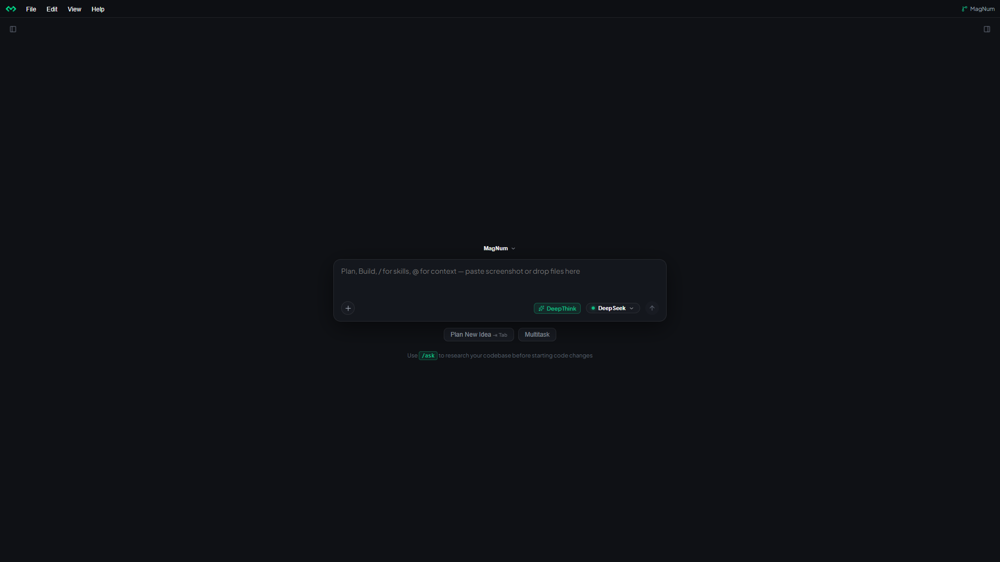
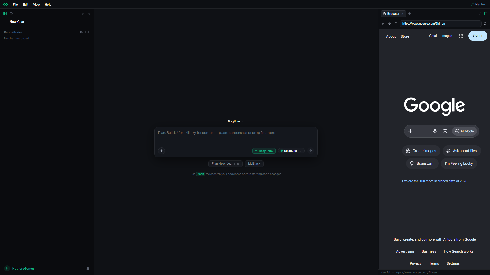

<div align="center">

  

  <h1>MagNum</h1>
  <p><strong>Autonomous Software Engineering Workspace & AI Coding Agent</strong></p>

  <p>
    <a href="https://github.com/mbbgreen/magnum/blob/main/LICENSE"></a>
    <a href="https://tauri.app/"></a>
    <a href="https://www.rust-lang.org/"></a>
    <a href="https://react.dev/"></a>
    <a href="https://www.typescriptlang.org/"></a>
    <a href="#"></a>
  </p>

  <p>
    MagNum is a high-performance, local-first autonomous software engineering workspace built with Tauri v2, Rust, and React. It connects directly with DeepSeek and Google AI Studio (Gemini) through secure, client-side stealth browser automation — no cloud relays, no subscription markups.
  </p>
</div>

---

## Interface Preview

<div align="center">
  
  <p><em>Autonomous Agent Workspace & Embedded Browser Inspection</em></p>

  <br />

  
  <p><em>Interactive PowerShell Terminal & Visual Hunk Diff Inspector</em></p>
</div>

---

## Key Features

- **Autonomous Multi-Turn Agent Loop:** Inspects directories, reads files (up to 5,000 lines/chunk), runs code grep, creates files, executes shell commands, and generates smart surgical multi-file patches.
- **Multi-Model Provider Dock:** Seamlessly toggle between **DeepSeek** (with DeepThink reasoning) and **Google Gemini** (via Google AI Studio with adjustable Low/Medium/High thinking levels).
- **Built-in Engineering Skills:** Instant workflow specialization with dedicated skills including `/plan`, `/debug`, `/multitask`, and `/ask`.
- **Advanced Workspace Inspector:**
  - **Changes Tab:** Visual unified diff viewer with hunk folding, line-by-line inspection, and atomic single-click file revert.
  - **Live Terminal:** Real-time integrated PowerShell with inline prompt tracking, shell restarts, and Ctrl+C interrupt support.
  - **Native In-App Webview:** Embedded Chromium browser with live text-reading and search grounding via dynamic CDP bridging.
  - **File Explorer:** Workspace tree viewer with Monaco Editor syntax highlighting.
- **Safety & Human-in-the-Loop:** Toggleable approval gates for patch application and shell command execution.
- **Local-First & Privacy-Centered:**
  - All chats and diffs persist in local **SQLite** (`magnum.db` with WAL mode).
  - Inter-process communication uses a cryptographically generated 64-character token via authenticated local WebSockets (`localhost:5454`).
  - Browser sessions and login cookies stay strictly on your local disk (`AppData/Local/MagNum`).
- **Tailored Interface & Localization:** Modern dark and light workspaces, F11 fullscreen workflow, and native English and Persian (RTL) localization.

---

## System Architecture

MagNum uses a 3-tier hybrid architecture combining native performance, OS integration, and fast web technologies:

```text
+-------------------------------------------------------------+
|                        MagNum Desktop UI                    |
|      React 18 + TypeScript + Vite + Tailwind/Custom CSS     |
|      (Monaco Editor, Visual Diff Viewer, Lucide)            |
+------------------------------+------------------------------+
                               | Tauri IPC / Events
+------------------------------v------------------------------+
|                      Rust Core (src-tauri)                  |
|  - Windows Job Object (auto-termination of child procs)     |
|  - Dynamic CDP Remote Debugging allocation                  |
|  - Single Instance Guard & Native Window Decorations        |
|  - Secure .ws-token reader & Updater Gate                   |
+------------------------------+------------------------------+
                               | Auth WS (localhost:5454)
+------------------------------v------------------------------+
|                  Node.js Backend Engine Daemon              |
|  - CodingAgent (tool calling, loop controller)              |
|  - ProjectTools (AST-free resilient fuzzy patch engine)     |
|  - Drivers (DeepSeek Stealth Driver & Gemini Driver)        |
|  - Storage (SQLite Sync Database via WAL mode)              |
+-------------------------------------------------------------+
```

---

## Repository Structure

```text
├── MagNum/                      # Main desktop application
│   ├── src/                     # React frontend (Components, Hooks, i18n, Styles)
│   ├── src-tauri/               # Rust source code, capabilities & Tauri config
│   │   └── resources/backend/   # Node.js Agent Engine (server.js, tools, drivers)
│   └── vite.config.ts
├── installer/                   # Standalone installer application (Tauri)
│   ├── src/                     # Installer setup UI (React)
│   └── src-tauri/               # Rust installer logic & payload extractor
├── build-setup.js               # Unified pipeline builder (App -> Payload -> Setup.exe)
├── download-fonts.js            # Self-hosted offline font bundle fetcher
└── LICENSE                      # MIT Open Source License
```

---

## Getting Started

### Prerequisites

- **Node.js:** v20.x or v22.x+ (Recommended: Node 22+ with native `node:sqlite`).
- **Rust & Cargo:** Stable toolchain (`rustup default stable`).
- **C++ Build Tools:** Visual Studio C++ Build Tools installed on Windows.
- **Google Chrome** or **Microsoft Edge** installed.

### 1. Clone & Install Dependencies

```bash
git clone https://github.com/mbbgreen/magnum.git
cd magnum

# Install frontend dependencies
cd MagNum
npm install

# Install installer dependencies
cd ../installer
npm install
cd ..
```

### 2. Download Offline Fonts (First-time setup)

MagNum bundles its fonts offline (JetBrains Mono, Plus Jakarta Sans, Vazirmatn) to ensure no remote telemetry calls:

```bash
node download-fonts.js
```

### 3. Running in Development Mode

Run the main application with live hot-reloading:

```bash
cd MagNum
npm run tauri dev
```

---

## Building Production Release

MagNum provides an automated pipeline in `build-setup.js` that:

1. Builds the core React frontend and compiles the Rust binary.
2. Stages the backend engine and packages it into an internal payload.
3. Compiles the custom standalone installer (`MagNum-Setup.exe`).

```bash
# From the repository root:
node build-setup.js
```

The resulting standalone setup executable will be generated at:

```text
installer/src-tauri/target/release/MagNum-Setup.exe
```

---

## Privacy, Security & Architecture Disclosure

MagNum was engineered specifically for developers who want the power of state-of-the-art reasoning models directly applied to their local codebases without paying subscription markups or sending source code to untrusted cloud relay servers:

- **Zero Cloud Proxies:** All prompts, file contents, diffs, and terminal outputs stay strictly between your computer and the official provider endpoint you choose.
- **Local Browser Automation:** MagNum does not ask you to paste API keys into third-party servers. It drives a local, stealth-configured Chromium instance linked directly to your authenticated session.
- **WebSocket Protection (CSWSH Defense):** The internal communication port rejects any request whose origin is not in the whitelist and requires a single-use 64-character cryptographic token (`.ws-token`) generated upon every boot.
- **Non-Destructive Git-Free Revert:** Every code modification generates a forward and backward diff saved inside `edits.db`. You can revert any agent action at any time even in folders without a Git repository.

### Why Local Automation?

MagNum intentionally avoids routing code through third-party relay services. The agent engine runs **entirely on your machine** and only communicates with the model provider you explicitly select. This design minimizes the attack surface, removes intermediary data exposure, and keeps every artifact (chats, diffs, cookies) within your OS user profile.

---

## Contributing

Contributions are welcome! Please feel free to submit a Pull Request.

1. Fork the Project
2. Create your Feature Branch (`git checkout -b feature/AmazingFeature`)
3. Commit your Changes (`git commit -m 'Add some AmazingFeature'`)
4. Push to the Branch (`git push origin feature/AmazingFeature`)
5. Open a Pull Request

---

## License

Distributed under the **MIT License**. See the [LICENSE](LICENSE) file for more information.

---

<div align="center">
  <sub>Engineered by <strong>Nethers Games</strong> &copy; 2026. All rights reserved.</sub>
</div>
